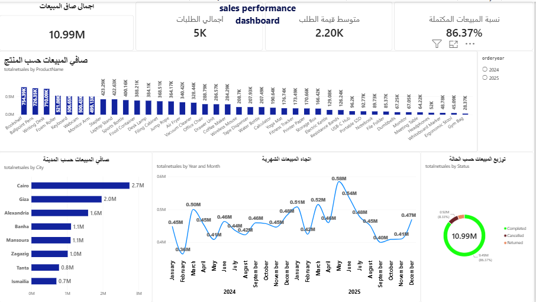

# Power-BI-Sales-Analysis 
Sales Analysis Dashboard | Power BI

Project Overview

An interactive sales dashboard built with Power BI to analyze sales performance across cities, months, and order statuses.

Dataset

- 5,000 sales transactions
- Sales, Products, Customers, and Targets tables

Tools & Technologies

- Power BI
- Power Query
- DAX

Data Preparation

- Cleaned and transformed data using Power Query.
- Prepared date fields for monthly analysis.
- Connected related tables to support interactive reporting.

Key Analysis

- Net sales by city.
- Monthly sales trends.
- Sales distribution by order status.
- Key performance indicators displayed in cards.

Project Files

- "Power-BI-Sales-Analysis.pbix" — Power BI report.
- "Dashboard.png" — Dashboard preview.

Objective

To transform sales data into an interactive report that supports business analysis and decision-making.
## Dashboard Preview

